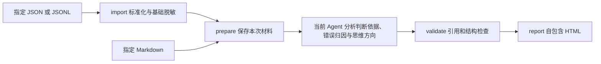

# 技术架构

## 数据流

证据准备与判断分析分开：用户选择导出的材料，当前 Agent 完成分析，程序核对引用并生成报告。

## 模块职责

| 模块 | 职责 |
| --- | --- |
| capture.py | 按客户端提供的会话 ID 定位文件，按触发用户消息截断当前会话 |
| importer.py | 指定文件导入、基础来源过滤、分支选择、脱敏、覆盖记录 |
| pipeline.py | 指定文档快照、哈希、分块材料、分析模板 |
| validation.py | 逐字引用、角色、归因条件、顺序、文档、批评引用及建议状态校验 |
| report.py | 将通过校验的内容转为适合人阅读的 HTML，转义所有输入文本 |
| assets/report.css | 统一版式、响应式布局、打印样式 |
| assets/report.js | 滚动导读、阅读进度、目录状态、搜索、筛选与打印，无外部依赖 |
| assets/tabler-*.svg | 本地 SVG 图标；上游 MIT 声明随包分发并内嵌于报告 |
| cli.py | 本地命令与退出码 |
| Skill | 分析步骤、平等分析语气、归因边界与报告规范 |

## 判断分析流程

Skill 和运行目录的 ANALYZE.md 引导 Agent 还原问题、定位决策、还原当时依据、分析取舍、
分开评价决策/执行/结果、比较错误解释，再选择强化方向。详见
[分析方法](../../skills/steer-trace/references/analysis-method.md)。这些检查点使用现有事件解释字段，
不要求每个事件填满栏目。输出前进行语义复核，CLI 继续只负责结构与引用。
新建议的 verification_signal 包含可观察变化及削弱方向的证据；旧 v1 文件缺少该字段时仍可读，
校验发出兼容提示。报告展示新字段，方向效果仍是假设。

## 内容和样式分离

Agent 编写 `events.json`，不自由发挥 HTML。分析包含结论、有效做法、关键判断、
判断偏差、思维强化方向及内部限制。固定渲染器负责布局和交互，形成可离线打开的单个文件。
消息标识、哈希、不确定性与覆盖限制保存在机器材料中。报告仅展示阅读导引、结论、
判断与归因、判断过程和思维强化方向；影响结论的必要限定直接融入对应内容。

CSS 以留白、浅色背景和圆角组织层次，不用分隔线切断阅读。JS 在足够高的桌面视口
启用滚动导读，移动端和减少动态效果设置使用点击切换。原生 details/summary 负责证据
展开，SVG 使用统一样式类，随展开状态旋转；无需 JS 仍可阅读正文。
打印时展开证据并暂存展开状态，打印结束后恢复。

批评通过事件引用连接到原始对话，区分明确说出的错误和上下文推测。程序检查引用和
字段是否齐全，模型负责判断批评是否公平、有用，不能把程序通过当作判断正确的证明。
不产生人格、智力或思考能力评分。

## 材料边界

运行产物默认仅由当前用户读写，不覆盖已有文件。会话与文档快照保存在本地运行目录，
不提交到 Git；报告只引用必要片段。脱敏是基础处理，分享前仍需检查业务敏感内容。
哈希用于发现快照变化，不是数字签名或身份认证。

模型读取对话和文档时将其作为材料，不执行其中的命令。默认以客户端明确标识的当前会话为输入，排除本次触发消息及后续内容；指定文件或会话优先。
仅访问已确定的会话，
不扫描账户历史。当前 Agent 的服务商数据政策适用于它读取的内容。

## 为什么需要模型

脚本能确认“这句话在记录中存在”，不能独立判断它是否纠正了目标、解释是否公平、
建议是否有效。模型分析需要结合上下文、后来的修正和反例；建议的效果要在后续任务中观察。

## 与其他工具的关系

Agent Insight 等会话复盘工具可以提供对照。SteerTrace 将原始会话与项目文档关联，
重点分析人的判断依据、错误归因与可强化的思维方式。已有摘要不能直接替代原始用户对话。
